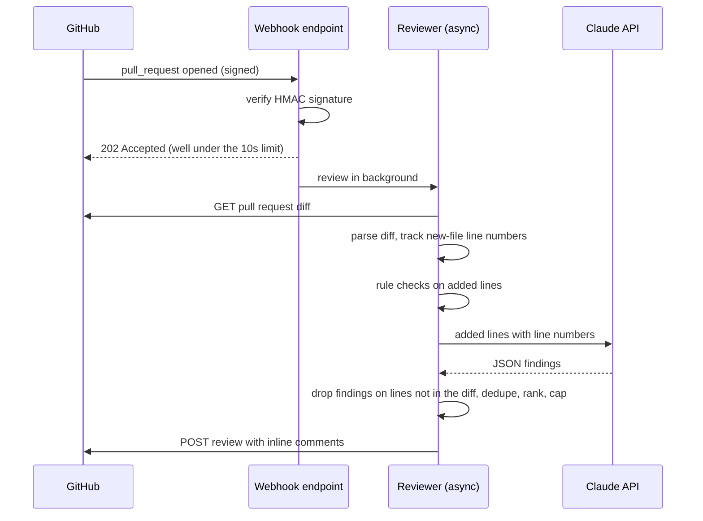

# AI Code Review Agent

[](https://github.com/junaidahmed9909/ai-code-review-agent/actions/workflows/ci.yml)

Code review is where teams catch bugs, but a lot of reviewer time goes to the same handful of issues: an empty catch block, a string compared with `==`, a password someone forgot to pull out. By the time a human gets to the interesting parts, they're tired.

This agent takes the first pass. When a pull request opens, GitHub calls a webhook, the agent reads the diff, runs fast rule checks, asks an LLM to look for deeper problems, and posts inline comments right on the lines that need attention. Every AI comment is checked against the diff before it's posted, so the model can't comment on lines that don't exist.

**Stack:** Java 21 · Spring Boot 3.5 · GitHub REST API & webhooks (HMAC-verified) · Claude Messages API · Micrometer · Docker · GitHub Actions

---

## How it works



### What the rules catch

| Rule | Severity | Why it matters |
|---|---|---|
| `HARDCODED_SECRET`, `AWS_ACCESS_KEY` | High | Anything in git should be treated as leaked (checked in every file type) |
| `SQL_CONCATENATION` | High | SQL injection |
| `EMPTY_CATCH` | High | Errors vanish without a trace |
| `STRING_REFERENCE_EQUALITY` | Medium | `==` compares identity, not content |
| `BIGDECIMAL_FROM_DOUBLE` | Medium | `new BigDecimal(0.1)` carries float error into money math |
| `CATCH_GENERIC_EXCEPTION` | Medium | Hides unexpected failures |
| `PRINT_STACK_TRACE` | Medium | Bypasses logging |
| `SYSTEM_OUT`, `THREAD_SLEEP`, `FIELD_INJECTION`, `TODO_COMMENT` | Low | Maintainability |

The LLM pass then looks for things rules can't see: null handling, concurrency, resource leaks, transaction boundaries and logic errors.

### Guardrails

- **Signed webhooks only.** Requests without a valid `X-Hub-Signature-256` are rejected before the body is parsed, using a constant-time comparison.
- **No off-diff comments.** AI findings pointing at a file or line the PR didn't add are dropped and counted (`aiCommentsRejectedAsOffDiff` in `/api/stats`).
- **Rules win ties.** If a rule and the model flag the same line, the deterministic comment is kept.
- **Noise cap.** At most 20 comments per review, highest severity first; the rest are summarized.
- **Graceful fallbacks.** No API key means rules only. A model outage becomes a warning. If GitHub rejects a comment position, the findings are posted in the review body instead.
- **Dry-run mode.** `REVIEW_POST_TO_GITHUB=false` reviews and logs without posting.

## Quick start (no GitHub needed)

```bash
mvn spring-boot:run

# Review the included sample diff
curl -s -H 'Content-Type: text/plain' --data-binary @sample-diffs/payment-service.diff \
  http://localhost:8080/api/reviews | jq '.comments[] | {severity, ruleId, line, message}'

# Or review your own work in progress
git diff main | curl -s -H 'Content-Type: text/plain' --data-binary @- http://localhost:8080/api/reviews | jq -r .summaryMarkdown
```

Add `export ANTHROPIC_API_KEY=...` before starting to turn on the AI pass.

## Connecting it to a GitHub repo

1. **Create a token.** A fine-grained personal access token limited to your test repos, with *Pull requests: Read and write* and *Contents: Read*.
2. **Expose the app.** Deploy it (see below), or for local testing use a tunnel such as `ngrok http 8080`.
3. **Add a webhook** in the repo: Settings → Webhooks → Add webhook.
   - Payload URL: `https://<your-host>/webhooks/github`
   - Content type: `application/json`
   - Secret: a long random string
   - Events: *Pull requests* only
4. **Start the app** with:

```bash
export GITHUB_TOKEN=github_pat_...
export GITHUB_WEBHOOK_SECRET=the-same-secret
export ANTHROPIC_API_KEY=...          # optional
mvn spring-boot:run
```

5. Open a pull request. GitHub's webhook page shows the delivery and the agent's `202` reply; the review appears on the PR a few seconds later.

## Running it as a GitHub Action (no server)

`.github/workflows/review.yml` runs the same engine on every pull request in this repo using `ReviewCli`, with the built-in `GITHUB_TOKEN`. No hosting or webhook needed. Copy that workflow into any Java repo to use it there, and add an `ANTHROPIC_API_KEY` repository secret to turn on the AI pass.

## Configuration

| Property | Env var | Default |
|---|---|---|
| `github.token` | `GITHUB_TOKEN` | empty |
| `github.webhook-secret` | `GITHUB_WEBHOOK_SECRET` | empty (webhook returns 503 until set) |
| `github.post-reviews` | `REVIEW_POST_TO_GITHUB` | `true` |
| `llm.api-key` | `ANTHROPIC_API_KEY` | empty (rules only) |
| `llm.model` | `LLM_MODEL` | `claude-sonnet-5-5` |
| `review.max-comments` | | `20` |
| `review.max-ai-files` | | `8` (largest changes first) |
| `review.max-ai-chars-per-file` | | `12000` |

## Measuring whether it helps

`GET /api/stats` reports reviews run, files reviewed, comments posted, findings per rule, AI comments rejected as off-diff, and average review time. Each comment invites a 👍 or 👎 reaction; counting those (GitHub's reactions API, or just by hand at first) gives an acceptance rate per rule. Rules that keep getting 👎 should be tuned or removed.

Fill this in once real PRs have gone through it:

| Measurement | Result |
|---|---|
| Repos / PRs reviewed | _fill in_ |
| Comments posted | _fill in_ |
| Helpful rate (👍 / reacted) | _fill in_ |
| Median review time | _fill in_ |

## Testing

```bash
mvn verify
```

Covers diff parsing (multiple hunks, renames, deletions, "no newline" markers), every rule plus false-positive cases, the composer's ranking and validation, HMAC signing against GitHub's published test vector, the webhook flow, the exact GitHub API requests (including the 422 fallback), and the AI pass with a fake model.

## Deploying

The app is stateless, so any container host works: AWS App Runner or ECS Fargate, Fly.io, Render. Build with the included `Dockerfile` and set the environment variables above. Keep the token and webhook secret in your platform's secret store.

## Design decisions worth talking about

- **Why async after the webhook?** GitHub waits 10 seconds for a reply. An LLM review can take longer, so the endpoint verifies, acknowledges with 202, and works in the background.
- **Why track new-file line numbers so carefully?** GitHub rejects review comments on lines outside the diff, and one bad position fails the whole review. Parsing hunks precisely, and validating AI output against them, avoids that.
- **Why rules plus AI?** Rules are free, instant and never hallucinate, so they handle the predictable problems. The model is saved for judgment calls, which keeps cost and noise down.
- **What I'd add next:** run as a GitHub App (per-installation tokens instead of a PAT), a queue for retries, suggested-change blocks GitHub can apply in one click, and per-repo rule configuration.

## Project layout

```
src/main/java/com/junaid/review
├── core/      diff parser, rule checker, composer, prompts, webhook signature
├── github/    GitHub REST client and settings
├── llm/       LLM client interface and the Claude implementation
├── service/   review engine, async PR reviewer, stats
├── api/       webhook endpoint, review API, error handling
└── config/    bean wiring and review settings
sample-diffs/  a realistic diff with known issues
```
